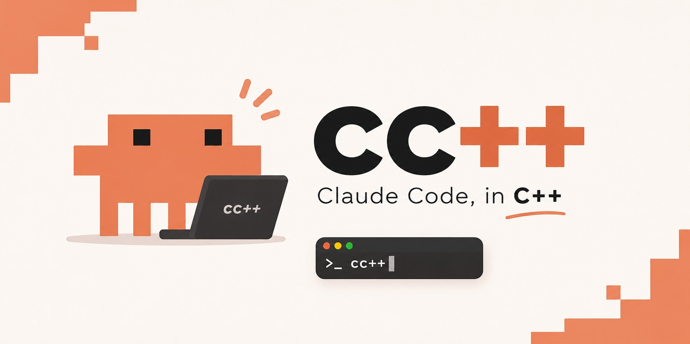
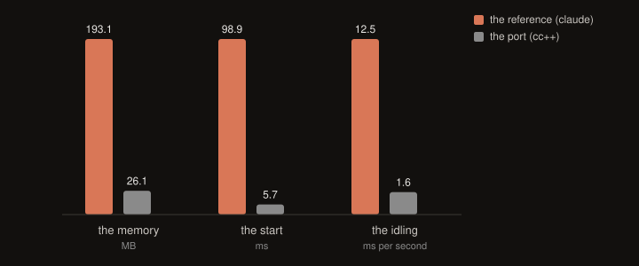

# Claude Code — C++23 port



A C++23 rewrite of the [Claude Code](https://claude.com/claude-code) CLI, built on
[ai-sdk-cpp](https://github.com/mhdimo/ai-sdk-cpp) and
[maya](https://github.com/agentty-org/maya).

The port is not a reimagining: it follows the reference implementation closely
— the same tools, the same input schemas, the same result strings, the same
colours and the same terminal layout. It reads and writes the same files, so
that the two may be used one after the other.

**The program is run as `cc++`.** The release is at
[github.com/mhdimo/cc_cpp](https://github.com/mhdimo/cc_cpp/releases).

## The port and the reference

The reference is a bundle of JavaScript that runs on Bun; the port is a native
binary. Both are measured the same way — the session is started under a pty,
the tree of processes is watched, and the numbers are taken in a home of
their own with nothing in it.



| | the reference | the port | |
|---|---|---|---|
| the memory of the session | 193 MB | 26 MB | **7.4× less** |
| the time to the first screen | 99 ms | 6 ms | **17× quicker** |
| the CPU while the session waits | 12.5 ms/s | 1.6 ms/s | **7.8× less** |

Each group of the graph has a scale of its own — the three numbers count in
three different units — so the bars are to be read within their group.

The graph and the numbers are written by `python3 scripts/bench.py`, which
writes `docs/bench.svg`, `docs/bench.html` and `docs/bench.json`. The page
holds the graph and the table of the numbers:
[docs/bench.html](docs/bench.html).

## Installing

```sh
scripts/package.sh                       # writes dist/claude-code-cpp-<version>-<arch>.tar.gz
scripts/install.sh ~/.local/bin/cc++     # puts it where the reference puts it
```

The install follows the layout of the native installer of the reference: the
binary itself lives in `~/.local/share/claude/versions/<version>` and
`~/.local/bin/cc++` is a symlink to it, so that the two agree about where the
program is. `~/.local/bin` has to be in your `PATH`.

There is a man page in `docs/cc++.1` and a Homebrew formula in
`packaging/homebrew/cc-cpp.rb`.

## Building

```sh
cmake -G Ninja -B build -DCMAKE_BUILD_TYPE=RelWithDebInfo
cmake --build build -j$(sysctl -n hw.ncpu)
```

The build fetches three dependencies: `ai-sdk-cpp` (the model SDK), `Catch2`
(the test framework) and `maya` (the terminal toolkit).

Requirements: a C++23 compiler, CMake 3.24+, Boost (headers only) and OpenSSL.

### Making the build quicker

The port is 250 files of its own and 82 of tests, and the headers of Boost
and of the SDK are heavy. Four things make the loop of the day quicker, and
the build finds the first two by itself:

| what | how | what it buys |
|---|---|---|
| the cache of the objects | `brew install ccache` | the second build of a change is a link, not a compile |
| the build that changes nothing | `-G Ninja` | 0.02 s instead of 2.15 s |
| the code of the day | `-DCMAKE_BUILD_TYPE=Debug` | the files are compiled with `-O0`, so three times quicker |
| the debug information of its own | `-DCC_SPLIT_DWARF=ON` | the objects are half the size and the link is quicker |

Measured on a ten-core machine, with `cli/app.cpp` (the heaviest file of the
tree, 7800 lines) as the example:

| build | before | after |
|---|---|---|
| nothing changed | 2.15 s | 0.02 s |
| one file changed | 12.3 s | 9.8 s, and 0.03 s the second time |
| the heaviest header changed | 14.0 s | 14.0 s, and 0.02 s the second time |
| everything, from nothing | 1 min 48 s | 1 min 48 s |

The clean build does not get quicker: the same work is done. The loop of the
day does, because the second build of a change is a link.

## Running

```sh
./build/src/cc++                   # the interactive prompt
./build/src/cc++ "explain this"    # one prompt, then exit
./build/src/cc++ -p "explain"      # print the answer and exit
./build/src/cc++ --help            # every flag
```

`ANTHROPIC_API_KEY` must be set. The session reads the same settings files as
the original: `~/.claude/settings.json`, `.claude/settings.json` and
`.claude/settings.local.json`, and the same memory files (`CLAUDE.md`).

The first time the session runs in a folder it asks whether you trust it, the
way the original does, and remembers the answer in `~/.claude.json`.

### The same data as the original

The port and the original can be used one after the other: they read and write
the same files.

| What | Where |
|---|---|
| the settings | `~/.claude/settings.json`, `.claude/settings.json`, `.claude/settings.local.json`, the managed settings of the system |
| the configuration of the user | `~/.claude.json` (and the legacy `~/.claude/.config.json`) |
| the memory | `~/.claude/CLAUDE.md`, `CLAUDE.md` of the folder, `~/.claude/rules/` |
| the conversations | `~/.claude/projects/<folder>/<session>.jsonl` |
| the history of the prompts | `~/.claude/history.jsonl` |
| the statistics | `~/.claude/stats-cache.json` |
| the output styles | `~/.claude/output-styles/` |
| the agents, the commands, the skills | `~/.claude/agents/`, `~/.claude/commands/`, `~/.claude/skills/` |
| the plugins | `~/.claude/plugins/` |
| the servers of MCP | `~/.claude.json`, `.mcp.json` of the folder |
| the keys the user has bound | `~/.claude/keybindings.json` |
| the copies of the files that changed | `~/.claude/file-history/` |

`CLAUDE_CONFIG_DIR` moves the folder of the configuration, the way it moves
it for the original.

## The layout of the tree

| Directory | What lives there |
|---|---|
| `src/core/` | Errors, identifiers, the conversation message types, the version |
| `src/types/` | The shared vocabulary — the permission modes and rules |
| `src/permissions/` | The permission engine: rules, modes, the decision pipeline |
| `src/tools/` | The `Tool` interface and the builtin tools |
| `src/query/` | The engine that runs the conversation |
| `src/ui/` | The terminal layer: theme, terminal, markdown, diff, prompt box, spinner, dialogs |
| `src/cli/` | Argument parsing and the REPL |
| `src/commands/` | The slash commands |
| `src/config/` | Settings files, the memory files, the trust decision |
| `src/session/` | The transcript on disk, resuming and compaction |
| `src/agents/` | The sub-agent definitions, loaded from `.claude/agents/` |
| `src/hooks/` | The hook runner, for the commands registered around tool calls |
| `src/mcp/` | The MCP client and the tools, resources and prompts the servers offer |
| `src/utils/` | Strings, paths, files and JSON helpers |
| `scripts/` | The installer, the script that builds the archive of a release, the benchmark |
| `packaging/` | The Homebrew formula |
| `docs/` | The man page, the graph of the benchmark |

The notes of the releases are in `CHANGELOG.md`, and the program shows them
in the banner and in the `/release-notes` command.

## Testing

```sh
./build/tests/claude_code_tests    # the unit tests
python3 tests/pty_smoke.py          # drives the CLI through a pty
python3 tests/compare_screens.py    # the screens of the port against the reference's
python3 tests/golden_screens.py     # the screens against the ones that are held
python3 scripts/bench.py            # the memory and the CPU, and the graph
```

The unit tests cover the tools, the permission rules, the markdown and diff
renderers, the prompt box, the overlays, the commands of the session, the
reader of the patterns of the hooks, the plugins and the fidelity of the
smaller details — the example command in the prompt box, the shortcuts menu,
the help overlay, the picker, the code of the mobile application, the output
of a shell command and the error of a tool.

There are thirteen pty suites. They check what the CLI actually draws: the
startup banner, the trust dialog, the prompt bar, typing, the shortcuts menu,
the suggestions overlay, the help overlay, the transcript view, the diff view,
the code of the mobile application, the command of a plugin, the side
question, the plan mode, the rewind, the keys of vim, the permission mode
cycle, the shell of the session, the compact that comes by itself, the
double-tap escape and a clean exit.

The screen comparison drives the port and the Claude Code CLI that is
installed on the machine through the same steps — the trust dialog, the
banner, the list of the commands, the panel of the configuration — and
compares the screens they draw, cell by cell, with the colours as well. The
installed CLI is an older build of the same product than the tree the port
was written from, so a difference that it reports is checked against the
tree before it is taken as a divergence of the port.

The golden screens are the ones the port has to keep: they are written from
the port itself and every difference between the port and the reference is a
difference the port has to make first.

The benchmark is the one that draws the graph at the top of this file.
